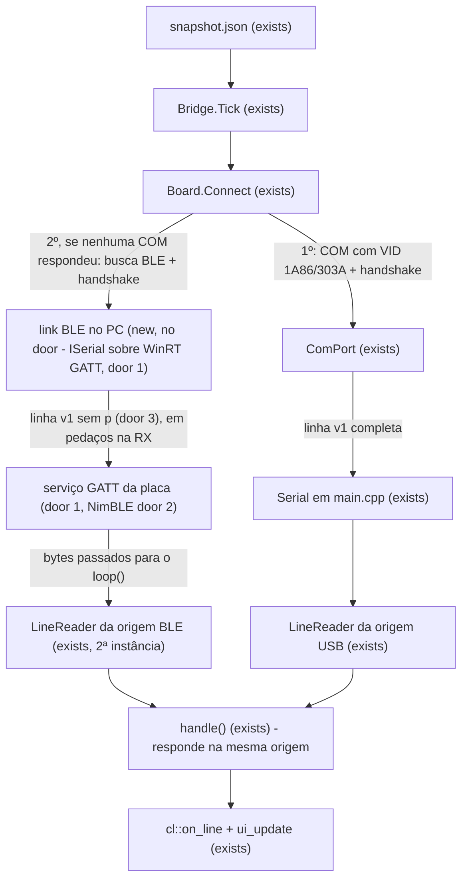

# Link BLE entre o PC e a placa

## Problem

Hoje a linha de uso só chega à placa pelo cabo USB de dados plugado no PC onde o Claude Code
roda. A placa fica presa ao lado do gabinete ou do notebook, ao alcance do cabo, e cada vez que
ela muda de PC (casa ↔ trabalho) o cabo tem que ir para uma porta USB livre daquela máquina.
A placa não tem bateria, então continua precisando de energia, mas não necessariamente daquele PC.
O pedido não traz números; fica registrado sem métrica.

O plano do Claudinho deixou o BLE para quando a AMOLED chegasse, mas o ESP32-WROOM-32 da CYD já
tem BLE 4.2. O firmware atual ocupa 704 KB numa partição de 3 MB (`huge_app.csv`).

Quando isso estiver pronto: a placa pode ficar em qualquer carregador USB a poucos metros do PC,
e o bridge a acha sozinho por Bluetooth, sem parear e sem configurar nada. Plugada no USB do PC,
ela continua funcionando exatamente como hoje.

## Flow

Reaproveita a linha v1, o `Bridge.Tick`, a interface `ISerial` com o handshake `?` → `claudinho 1`
e, no firmware, o `cl::LineReader` e o `handle()`. O BLE entra como uma segunda implementação
de `ISerial` no PC e como uma segunda origem de bytes no firmware, sem um segundo protocolo.

## Impact

| Front | What changes |
| --- | --- |
| domain | termo existente: `link` era só a COM; agora é USB ou BLE. Quem decide é `Board.Connect`; `Bridge.Tick` não distingue os dois |
| domain | AD-002 dizia "uma única linha JSON, igual em qualquer transporte"; pelo BLE a linha sai sem a chave `p` (door 3). Quem lê `p` hoje é o `make_view` do firmware (`claudinho_core.cpp:240`), que já mostra só o modelo quando `proj` vem vazio. `v` continua 1 |
| firmware | +NimBLE no `env:cyd`. Flash: de 704 KB para 1,01 MB, numa partição de 3 MB. RAM: com o BLE, o bloco fixo de 64 KB do LVGL (`LV_MEM_SIZE`) não cabia na DRAM estática (estourou 12,7 KB no link); o LVGL passa a usar o `malloc` do sistema (`LV_USE_STDLIB_MALLOC LV_STDLIB_CLIB`) e divide o heap com o BLE. O boot imprime `heap livre N` na serial |
| firmware | o `loop()` lê de duas origens; o callback do NimBLE roda em outra task do FreeRTOS, então os bytes passam por um buffer e só o `loop()` chama `handle()` e o LVGL |
| PC | `Board.Connect` ganha uma segunda tentativa; o `Bridge` não muda. TFM `windows10.0.19041` já expõe o WinRT BLE (door 4 do claudinho), sem pacote novo |
| docs | `README.md` diz que os dados chegam "pelo cabo USB"; passa a dizer USB ou Bluetooth |
| stored data | nada a migrar; `snapshot.json` não muda |

## Relations

None - no stored-data shape change

## Surface

None - nothing consumed outside this repo; o serviço GATT é a door 1 em Landing

## Landing

| One-way door | Literal shape | Alternative rejected |
| --- | --- | --- |
| 1. Serviço GATT da placa (a AMOLED vai herdar o mesmo) | Nordic UART Service: serviço `6E400001-B5A3-F393-E0A9-E50E24DCCA9E`; RX `6E400002-B5A3-F393-E0A9-E50E24DCCA9E` (write e write without response, PC → placa); TX `6E400003-B5A3-F393-E0A9-E50E24DCCA9E` (notify, placa → PC). Anúncio com o UUID do serviço e nome `Claudinho` na scan response. Os bytes da RX formam o mesmo fluxo da serial (linha v1 + `\n`, `?\n`) em pedaços de qualquer tamanho; a TX carrega `claudinho 1 cyd\n`. Um PC conectado por vez | Uma característica só de escrita recebendo a linha inteira (o que a door 3 do claudinho previa): a linha de até 512 bytes passa do MTU comum e exige escrita longa, e não há caminho de volta para o handshake, então o PC não confirma que achou um Claudinho antes de mandar dados. UUIDs próprios: não ganham nada e perdem os apps de UART genéricos (nRF Connect, Serial Bluetooth Terminal), que servem para depurar como o monitor serial serve hoje |
| 2. Pilha BLE do firmware (dependência nova) | `h2zero/NimBLE-Arduino@^2.5.1` no `lib_deps` do `env:cyd` | Biblioteca `BLE` do core (Bluedroid): segundo a descrição da própria NimBLE, ocupa o dobro de flash e ~100 KB a mais de RAM, numa placa sem PSRAM em que o LVGL já ocupa o heap |
| 3. `p` fica fora do ar (substitui a frase "igual em qualquer transporte" da AD-002) | Pelo BLE o bridge tira a chave `p` da linha v1 antes de enviar; o resto da linha e `"v":1` ficam iguais. Pelo USB nada muda | Parear e criptografar: exige parear cada PC nas Configurações do Windows e mais código nos dois lados (escolha do usuário). Mandar a linha inteira aberta: o nome da pasta do projeto vai para qualquer um a ~10 m |

- Nothing else in this change is hard to reverse: a ordem USB → BLE, a janela de busca e o tamanho dos pedaços mudam num commit

## Criteria

### S1: a placa recebe a linha por BLE (P1)

Com a placa só na tomada, um app de UART no celular manda a linha e a tela muda.

**Acceptance Criteria**

1. WHILE nenhum PC está conectado por BLE, o firmware SHALL anunciar o serviço `6E400001-B5A3-F393-E0A9-E50E24DCCA9E` com o nome `Claudinho`
2. WHEN uma linha v1 válida chega pela RX, em qualquer número de pedaços, THEN o firmware SHALL redesenhar a tela em até 1 s exatamente como se ela tivesse chegado pelo USB
3. WHEN `?\n` chega pela RX THEN o firmware SHALL notificar `claudinho 1 cyd\n` pela TX em até 1 s, e nada pela serial
4. IF uma linha chega pela RX malformada, truncada ou com mais de 512 bytes THEN o firmware SHALL descartá-la e manter a tela anterior
5. WHILE chegam bytes ao mesmo tempo pelo USB e pelo BLE o firmware SHALL montar cada linha só com bytes da própria origem
6. WHEN o PC desconecta THEN o firmware SHALL voltar a anunciar em até 2 s
7. The firmware SHALL continuar respondendo pelo USB como hoje: `?\n` → `claudinho 1 cyd\n` pela serial, e a linha v1 pela serial redesenha a tela

**Independent test:** placa num carregador; no nRF Connect, conectar em `Claudinho`, assinar a TX, escrever `?\n` e ver a resposta; escrever uma linha v1 e ver a tela mudar; desconectar e ver o anúncio voltar.

### S2: o bridge acha a placa por BLE quando ela não está no USB (P1)

Com a placa longe do PC e sem cabo de dados, a tela acompanha o Claude Code.

**Acceptance Criteria**

8. WHEN o bridge procura a placa THEN ele SHALL tentar primeiro o USB e, só se nenhuma COM responder ao handshake, buscar por até 5 s um dispositivo BLE que anuncie o serviço `6E400001-B5A3-F393-E0A9-E50E24DCCA9E`
9. WHEN o bridge acha um candidato BLE THEN ele SHALL assinar a TX, mandar `?\n` e só usar o link se receber uma linha começando com `claudinho 1 ` em até 3 s
10. WHILE o link é BLE o bridge SHALL enviar a linha v1 do snapshot sem a chave `p`, com todas as outras chaves e valores iguais
11. WHILE o link é BLE o bridge SHALL entregar a linha em até 2 s depois que o `snapshot.json` muda, e reenviá-la a cada 60 s
12. IF o link BLE cai (placa fora de alcance, reiniciada ou desligada) THEN o bridge SHALL registrar uma linha no `bridge.log`, tentar de novo a cada 5 s, USB primeiro, e continuar rodando
13. IF o PC não tem adaptador Bluetooth ou ele está desligado THEN o bridge SHALL continuar procurando só pelo USB e registrar `bluetooth indisponível` no máximo uma vez por execução
14. WHEN o bridge conecta à placa THEN ele SHALL registrar no `bridge.log` `conectado: usb COMn` ou `conectado: ble <endereço>`

**Independent test:** placa num carregador a ~3 m; `claudinho bridge` rodando; editar o `snapshot.json` e ver a tela mudar em até 2 s sem o nome do projeto; desligar a placa e ligar de novo e ver a tela voltar; o `bridge.log` mostra `conectado: ble ...`.

## Out of scope

| Excluded | Why |
| --- | --- |
| Pareamento e criptografia | Escolha do usuário: zero configuração nos dois PCs; o `p` sai do ar no lugar disso (door 3) |
| Ícone na tela dizendo se o link é USB ou BLE | Não foi pedido; o `bridge.log` mostra (AC 14) |
| Trocar para o USB quando o cabo é plugado com o BLE ativo | O BLE funciona; troca na próxima queda do link |
| Dois PCs conectados à placa ao mesmo tempo | A placa fica num lugar por vez; um PC conectado por vez (door 1) |
| Wi-Fi | Door 3 do claudinho continua valendo |
| Firmware da AMOLED | Continua fora; ela herda o serviço da door 1 e a NimBLE da door 2 |

## Assumptions

| Assumption | Chosen default | Rationale | Confirmed? |
| --- | --- | --- | --- |
| Energia da placa | Fonte USB na tomada; o cabo ao PC fica só para gravar o firmware e como reserva quando o PC não tem Bluetooth. A CYD não tem bateria, então sem a fonte ela desliga e a tela apaga | Dito pelo usuário em 2026-11-23 | y |
| USB continua como caminho de dados | Sim: USB primeiro, BLE depois (AC 8) | Escolha do usuário; funciona em PC sem Bluetooth | y |
| Quem pode escrever na placa | Qualquer um ao alcance pode conectar, mandar uma linha falsa ou ocupar a única conexão | Escolha do usuário (aberto, sem `p`); é um painel de mesa sem ações | y |
| PC do trabalho tem Bluetooth liberado pela TI | Não se sabe; se não tiver, o USB continua (AC 13) | Não bloqueia nada | n |
| Tamanho dos pedaços escritos na RX | O maior que a sessão GATT do Windows aceitar (`MaxPduSize` - 3), write with response | Menos escritas cabem no prazo de 2 s; a ordem é garantida dentro da conexão | n |
| Busca BLE quando a placa não está por perto | Repete a cada 5 s, com janela de 5 s, até o bridge sair por ociosidade (30 min) | Mesma cadência do USB; a busca passiva não incomoda ninguém | n |
| README | Troca "chegam à placa pelo cabo USB" por "pelo cabo USB ou por Bluetooth" e diz que basta a placa estar numa tomada a poucos metros | É o que muda para quem usa | n |
| Profile de verificação | `light`, como no claudinho | Padrão da skill | n |

**Open questions:** none - all resolved or logged above.

## Observable

| Surface | Decision | Landing |
| --- | --- | --- |
| command `claudinho bridge` | output format and verbosity | AC 13, AC 14 (só `bridge.log`) |
| command `claudinho bridge` | exit codes | existing - AC 7 e AC 13 do claudinho, sem mudança |
| command `claudinho bridge` | what it prints when it fails halfway | AC 12 |
| command `claudinho bridge` | flags and defaults | n/a - sem flag nova; o BLE é sempre a segunda tentativa |
| API serviço GATT `6E400001-…` | response and error shape | AC 3, AC 4 (lixo é descartado sem resposta, como na serial) |
| API serviço GATT `6E400001-…` | who may call it | Assumptions - aberto, escolha do usuário |
| API serviço GATT `6E400001-…` | versioning | existing - `v` da linha v1 (AC 21 do claudinho); UUIDs fixos pela door 1 |
| API serviço GATT `6E400001-…` | rate limit | n/a - um PC por vez, e o bridge manda no máximo uma linha por mudança mais uma a cada 60 s |
| screen `painel` | empty, loading, error, stale states | n/a - nenhum estado novo; sem `p` o `make_view` já mostra só o modelo |
| document `README.md` | structure and next step | Assumptions - README |

## Sources

- `.specs/STATE.md` AD-002 - o bridge é o dono do link e o BLE entraria nele; a door 3 deste plano refina a frase sobre a linha
- `.specs/features/claudinho/plan.md` door 3 e a linha "Link BLE" de Out of scope - o desenho previsto, que a door 1 daqui substitui
