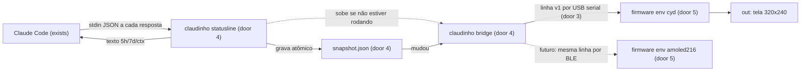

# Claudinho - monitor de limites do Claude Code, hoje na CYD cabeada, amanhã na AMOLED sem fio

## Problem

Hoje, para saber quanto ainda resta do limite de 5 horas e do limite semanal do Claude Code, você
precisa parar o que está fazendo e rodar `/usage`, ou abrir a página de uso no navegador. Os dois
estouram de surpresa no meio de uma tarefa, e o reset só aparece se você for procurar. Você
trabalha em dois PCs Windows (casa e trabalho), então qualquer solução que dependa de configurar
cada máquina na mão, de rede Wi-Fi ou de credenciais copiadas vai quebrar no segundo PC.
O pedido não traz números de quantas vezes o limite estourou; fica registrado sem métrica.

Há também um prazo implícito: a placa de hoje (ESP32-2432S028R, sem bateria, só cabo) vai ser
trocada por uma Waveshare ESP32-S3-Touch-AMOLED-2.16 (480x480, BLE 5, bateria) quando sobrar
verba. Se o que for construído agora não servir na placa nova, o trabalho é refeito.

Quando isso estiver pronto: você pluga a CYD no USB de qualquer um dos PCs, instala uma vez por PC,
e uma tela com o visual do Claude (paleta da marca e o Clawd animado) mostra o uso de 5h e 7d, as contagens regressivas até o reset e
o contexto/custo da sessão atual. Quando a AMOLED chegar, o PC continua igual: entra um firmware
novo na placa e, depois, um link BLE no bridge.

## Flow

Reaproveita o payload que o próprio Claude Code já entrega ao `statusLine`, em vez de ler token
OAuth, chamar endpoint de uso ou estimar a partir dos JSONL. Entre PC e placa existe um único
contrato (door 1), que independe de transporte.

1. Claude Code (exists) roda `claudinho statusline` a cada mensagem do assistente (debounce de 300 ms) e passa o JSON da sessão no stdin
2. `claudinho statusline` (door 4) - imprime o texto do terminal, grava `snapshot.json` (troca atômica do arquivo) e, se o bridge não estiver rodando, sobe ele em segundo plano. Nunca toca no hardware
3. `claudinho bridge` (door 4) - instância única por PC; mantém a porta aberta, acha a placa pelo VID USB + handshake, e envia a linha v1 (door 1) quando o snapshot muda e a cada 60 s
4. `firmware` core (door 5) - valida a linha, guarda o estado e conta o tempo até o reset sozinho; o desenho é uma camada por placa
5. out: tela da placa; no PC só ficam `claudinho.exe`, `snapshot.json` e o log do bridge em `%LOCALAPPDATA%\Claudinho\`

Instalação, uma vez por PC:

1. `claudinho install` (door 4) - copia o próprio exe para `%LOCALAPPDATA%\Claudinho\` e grava a chave `statusLine` em `~/.claude/settings.json` (exists), com backup

## Impact

| Front | What changes |
| --- | --- |
| domain | novo termo: `Claudinho` - placa + firmware + `claudinho.exe` deste repo |
| domain | novo termo: `snapshot` - o último estado lido do statusline, que o bridge reenvia |
| PC config | `~/.claude/settings.json` ganha a chave `statusLine` em cada PC onde rodar o instalador; hoje este PC não tem nenhuma (o `ponytail-statusline.ps1` existe mas não está ligado no settings) |
| PC processos | um processo `claudinho bridge` fica rodando enquanto há sessão do Claude Code e sai depois de 30 min sem snapshot novo |
| terminal | a status line do Claude Code passa a mostrar `5h 24% · 7d 41% · ctx 37%` |
| stored data | nothing to migrate - só `snapshot.json`, `port.txt` (cache da COM) e `bridge.log` |

## Relations

None - no stored-data shape change

## Surface

None - nothing consumed outside this repo; o contrato PC → placa é a door 1 em Landing

## Landing

| One-way door | Literal shape | Alternative rejected |
| --- | --- | --- |
| 1. Contrato da linha PC → placa, igual em serial e BLE, versionado porque os dois PCs podem rodar versões diferentes | `{"v":1,"t":1763870000,"tz":-180,"h5":[23.5,1763880000],"d7":[41,1764300000],"ctx":37,"tok":152340,"usd":4.12,"m":"Opus","p":"monitor"}\n` (`tz` = fuso do PC em minutos, para mostrar dia e hora local), no máximo 512 bytes; janela ausente → chave omitida; chave desconhecida → ignorada. Handshake: PC envia `?\n`, placa responde `claudinho 1 <board>\n` (`cyd` ou `amoled216`) | CSV posicional: adicionar um campo quebra a placa quando o outro PC ainda roda o exe antigo. Binário: não dá para ler no monitor serial nem no nRF Connect ao depurar |
| 2. Fonte dos dados | stdin do `statusLine` do Claude Code: `rate_limits.five_hour/seven_day.{used_percentage,resets_at}`, `context_window`, `cost.total_cost_usd`, `model.display_name`, `workspace.project_dir` | Token OAuth + `GET /api/oauth/usage` (Clawdmeter, Claude Usage Stick): mexe em credencial, endpoint não documentado e precisa de rede no trabalho. Parsing dos JSONL (ccusage): só estima o bloco de 5h, não sabe o % real do limite |
| 3. Transporte: o bridge é dono do link; hoje USB serial, depois BLE | serial 115200 8N1; a placa é achada pelos VIDs `1A86` (CH340 da CYD) e `303A` (USB nativo do ESP32-S3) e confirmada pelo handshake. BLE futuro: um serviço GATT com uma característica de escrita que recebe a mesma linha | Statusline escrevendo direto na COM (o plano anterior): cada sessão abre e fecha a porta a cada resposta, duas sessões disputam a COM, o Claude Code cancela o script no meio da escrita, e BLE leva segundos para conectar, o que não cabe numa chamada de statusline. Wi-Fi: a placa precisaria de SSID/senha de cada lugar, e o Wi-Fi corporativo (WPA2-Enterprise, portal cativo, isolamento de clientes) costuma bloquear |
| 4. Runtime no PC | um único `claudinho.exe` em C#/.NET 10, self-contained e single-file, com os subcomandos `statusline`, `bridge`, `install` e `uninstall`; TFM `net10.0-windows10.0.19041.0` para ter BLE do Windows (WinRT) disponível depois; serial pelo pacote `System.IO.Ports`. Comando no settings: `C:/Users/<user>/AppData/Local/Claudinho/claudinho.exe statusline` (barras normais, porque o Git Bash come as invertidas) | PowerShell 5.1: BLE do WinRT pelo PowerShell é interop assíncrono frágil, e o `powershell.exe` leva ~300 ms para abrir a cada resposta. Python/Node: sem garantia de estarem no PC do trabalho. Rust (como o Clawdmeter): fora da sua stack; C# é o que você mantém |
| 5. Firmware: um projeto PlatformIO, núcleo compartilhado, uma env por placa, UI em LVGL | `firmware/lib/core` em C++ puro (protocolo, estado, contagem, formatação), sem Arduino, testado na env `native` com Unity; `firmware/src/ui` em LVGL 9 (barras, fontes Poppins e Lora convertidas com `lv_font_conv`, animações) com o layout escolhido pela resolução; Arduino_GFX só como driver de pixel: `Arduino_ILI9341` 320x240 na `env:cyd` (buffer parcial de 1/10 da tela, a CYD não tem PSRAM) e `Arduino_CO5300` 480x480 na `env:amoled216`; plataforma pioarduino (Arduino core 3.x, que os exemplos da Waveshare exigem); ArduinoJson 7 | Desenhar à mão com Arduino_GFX: sem fontes com antialiasing, cantos arredondados nem animação, o visual da demo não sai. TFT_eSPI: não tem driver para o CO5300 da AMOLED. Dois repositórios de firmware: o protocolo e a contagem ficariam duplicados e iam divergir |

- Nothing else in this change is hard to reverse

## Criteria

### S1: o statusline vira texto e snapshot, rápido, sem tocar em hardware (P1)

O subcomando chamado pelo Claude Code transforma o JSON em texto e em um arquivo.

**Acceptance Criteria**

1. WHEN o Claude Code roda `claudinho statusline` com `rate_limits.five_hour.used_percentage` = 23.5, `seven_day.used_percentage` = 41 e `context_window.used_percentage` = 37 THEN o `statusline` SHALL imprimir exatamente `5h 24% · 7d 41% · ctx 37%` e sair com código 0
2. IF o stdin não tem `rate_limits` ou uma das janelas THEN o `statusline` SHALL imprimir `--` no lugar do % dessa janela (ex.: `5h -- · 7d -- · ctx 37%`) e sair com código 0
3. IF o stdin não é JSON válido THEN o `statusline` SHALL imprimir `claudinho: sem dados`, não alterar `snapshot.json` e sair com código 0
4. WHEN o stdin é válido THEN o `statusline` SHALL gravar em `snapshot.json` exatamente os campos da door 1, com `p` = só o nome da pasta de `workspace.project_dir`, nunca o caminho completo
5. The `statusline` SHALL terminar em menos de 500 ms com a placa plugada ou não, porque não abre porta nenhuma
6. WHEN o `statusline` roda e nenhum `claudinho bridge` está rodando THEN ele SHALL iniciar o bridge desanexado, sem janela, e sair sem esperar por ele

**Independent test:** `Get-Content fixtures/full.json | claudinho statusline` imprime a linha esperada e o `snapshot.json` aparece.

### S2: o bridge entrega o snapshot à placa e se recupera sozinho (P1)

Um processo por PC, dono da porta, que hoje fala serial e depois BLE.

**Acceptance Criteria**

7. WHEN um segundo `claudinho bridge` é iniciado THEN ele SHALL sair com código 0 em menos de 1 s, deixando só o primeiro rodando
8. WHEN o bridge procura a placa THEN ele SHALL usar só uma COM cujo VID USB é `1A86` ou `303A` e que responda `claudinho 1 ` ao `?\n` em até 3 s
9. WHEN o `snapshot.json` muda THEN o bridge SHALL enviar a linha v1 correspondente à placa em até 1 s
10. WHILE a placa está conectada o bridge SHALL reenviar o snapshot atual a cada 60 s
11. WHEN o bridge (re)conecta à placa, inclusive depois de ela reiniciar ao abrir a porta THEN ele SHALL enviar o snapshot atual em até 3 s
12. IF a placa é desplugada ou a COM some THEN o bridge SHALL registrar uma linha em `bridge.log`, tentar de novo a cada 5 s e continuar rodando
13. WHEN se passam 30 min sem nenhuma mudança no `snapshot.json` THEN o bridge SHALL fechar a porta e sair com código 0

**Independent test:** com a placa plugada, rodar o bridge, editar o `snapshot.json` à mão e ver a tela mudar; desplugar e replugar e ver a tela voltar.

### S3: a tela mostra uso, reset e sessão com o visual do Claude (P1)

O núcleo do firmware decide o que mostrar; a camada LVGL só desenha. Referência visual: `design/painel.html`.

**Acceptance Criteria**

14. WHEN a placa recebe uma linha v1 válida THEN o firmware SHALL redesenhar em até 1 s mostrando, de cima para baixo: Clawd + frase de status + `modelo · projeto`; linha `Sessão` com % e barra horizontal e `renova em 2h16`; linha `Semana` com % e barra horizontal e `renova qui 20:11`; rodapé com contexto %, custo `US$ 4,12` e o horário da última leitura
15. The firmware SHALL usar só as cores da paleta: fundo `#141413`, trilho `#2b2a27`, faixa de ritmo `#45423c`, texto `#faf9f5`, secundário `#b0aea5`, terciário `#7a786f`, barra normal `#e8e6dc`, risco `#d97757`, ok `#8fa874`, suor `#6a9bcc`, olhos `#000000` (os tons intermediários do antialiasing não contam)
16. WHILE nenhuma linha chegou desde o boot o firmware SHALL mostrar o Clawd dormindo (olhos fechados, `z` subindo) e o texto `Esperando o Claude Code`
17. WHILE há dados recebidos o firmware SHALL diminuir as contagens regressivas uma vez por minuto usando `t` da última linha + `millis()`, sem precisar de linha nova
18. IF o `resets_at` de uma janela já passou THEN o firmware SHALL mostrar essa janela com `0%` e o texto `renovada ✓`
19. WHILE a última linha tem mais de 3 min o firmware SHALL manter os valores com 45% de opacidade e trocar o horário do rodapé (ponto verde) por `há N min` em laranja
20. IF uma linha chega malformada, truncada ou com mais de 512 bytes THEN o firmware SHALL descartá-la e manter a tela anterior
21. IF uma linha chega com `v` diferente de 1 THEN o firmware SHALL mostrar o Clawd com `?` e o texto `Firmware desatualizado` / `o PC mandou o protocolo vN`
22. IF uma linha válida chega sem `h5` ou sem `d7` (login por chave de API, conta sem cota de assinatura, ou antes da primeira resposta da sessão) THEN o firmware SHALL mostrar `--` na linha dessa janela com o texto `indisponível neste login` e a frase `Cota indisponível`, e continuar mostrando contexto e custo
23. WHEN o firmware recebe `?\n` THEN ele SHALL responder `claudinho 1 cyd\n` (na env `cyd`)

**Independent test:** pelo monitor serial do PlatformIO, colar uma linha v1 à mão e ver a tela; colar lixo e ver que nada muda; mandar `?` e ver a resposta.

### S4: levar para outro PC é baixar um exe e rodar um comando (P1)

Os dois PCs ficam iguais sem editar arquivo na mão.

**Acceptance Criteria**

24. WHEN `claudinho install` roda THEN ele SHALL copiar o próprio exe para `%LOCALAPPDATA%\Claudinho\`, salvar `~/.claude/settings.json` como `settings.json.claudinho.bak` e gravar `statusLine` = `{"type":"command","command":"<caminho do exe com /> statusline"}` mantendo todas as outras chaves com os mesmos valores
25. IF o `settings.json` já tem um `statusLine` que não é do Claudinho THEN o `install` SHALL sair com código 1 e a mensagem `statusLine já configurado; use --force para substituir`, sem alterar nada
26. WHEN `claudinho install` roda duas vezes seguidas THEN a segunda execução SHALL deixar o `settings.json` com os mesmos valores da primeira
27. WHEN `claudinho uninstall` roda THEN ele SHALL parar o bridge, remover a chave `statusLine` do Claudinho e a pasta `%LOCALAPPDATA%\Claudinho\`, sem tocar nas outras chaves
28. The `install` SHALL funcionar sem admin, sem .NET instalado no PC e sem Python ou Node

**Independent test:** num `settings.json` de fixture, rodar install → install → uninstall e comparar as chaves.

### S5: a placa real se comporta (P1)

Calibração de hardware: a CYD tem variantes de controlador de tela.

**Acceptance Criteria**

29. WHEN o firmware inicia na CYD THEN a tela SHALL mostrar o fundo `#141413` e o Clawd em `#d97757` (não azulado, que é o sinal de R e B trocados), em paisagem 320x240, sem espelhamento

**Independent test:** olhar a tela no boot.

### S6: a tela responde "vou bater no limite?" de relance (P1)

Frase, cor e pose do Clawd vêm de uma regra só, no `lib/core`, testável no PC. Racional em `design/painel.html` ("Por que está assim").

**Acceptance Criteria**

30. The firmware SHALL escolher a frase de status nesta ordem: `Limite atingido` (alguma janela ≥ 100%), `Ritmo acelerado` (a projeção linear de alguma janela chega a 100% antes do reset dela), `Quase no limite` (alguma janela ≥ 80%), `Tranquilo` (demais casos)
31. WHEN a frase é `Ritmo acelerado` THEN o firmware SHALL mostrar `nesse ritmo, acaba em <dur>`, com dur = (100 − usado) ÷ (usado ÷ minutos decorridos da janela), da janela que acaba primeiro
32. WHEN a frase é `Limite atingido` THEN o firmware SHALL mostrar `volta em <dur>` até o reset da janela que bateu 100%
33. The firmware SHALL marcar o ritmo em cada janela com uma faixa `#45423c` do início até a posição minutos decorridos ÷ duração da janela (5h = 300 min, 7d = 10080 min) e uma bolinha nessa posição: `#141413` sobre a parte usada, `#faf9f5` sobre o trilho; no limite, sem faixa e sem bolinha
34. The firmware SHALL pintar a barra e o % de uma janela de laranja `#d97757` só quando ela está em risco (≥ 80% ou projeção antes do reset), e de creme `#e8e6dc`/`#faf9f5` nos demais casos
35. The Clawd SHALL ter uma pose por estado: parado piscando a cada ~5 s (`Tranquilo`), braços para cima com gota de suor (`Ritmo acelerado`, `Quase no limite`), olhos `> <` e barra pulsando (`Limite atingido`), pulando com brilhos por 4,5 s quando a janela de 5h renova, olhos fechados com `z` (aguardando), `?` (protocolo)
36. WHILE a frase é `Tranquilo` o firmware SHALL não animar nada além da piscada do Clawd
37. The firmware SHALL mostrar o reset da semana como dia e hora local (`renova qui 20:11`), calculado com `resets_at` e `tz` da linha v1

**Independent test:** testes `native` do `lib/core` para a tabela de frases; na placa, colar à mão linhas com 18%, 62% em 100 min, 86% e 100% e ver frase, cor e pose.

## Out of scope

Cada item futuro já tem onde encaixar sem mexer no que existe.

| Excluded | Why |
| --- | --- |
| Firmware da AMOLED (`env:amoled216`) | A placa ainda não foi comprada. Quando chegar: nova env no `platformio.ini`, driver `Arduino_CO5300` 480x480, o mesmo `lib/core` e um layout próprio já desenhado na demo: a tela tem ~39 mm (0,08 mm/px), então fontes ~2x maiores em px, sem custo e sem modelo. O USB nativo dela (VID `303A`) já é reconhecido pelo bridge, então funciona cabeada no primeiro dia |
| Link BLE no bridge e no firmware | Depende da AMOLED. Entra como segunda implementação do link no bridge (WinRT GATT, já disponível pelo TFM da door 4) e um serviço NimBLE no firmware, carregando a mesma linha da door 1 |
| Bateria, brilho e sono da AMOLED | Depende da placa (PMIC AXP2101 via XPowersLib) |
| Toque, botões e atalhos de teclado (HID) | V1 é um painel único; o Clawdmeter mostra que dá para adicionar depois |
| Uso feito pelo claude.ai web/desktop enquanto o Claude Code está parado | O statusline só vê o novo % na próxima resposta do Claude Code |
| Wi-Fi e atualização OTA | Ver door 3 |
| Encadear um `statusLine` que já existe | O instalador recusa (AC 25) em vez de encadear |
| Histórico e gráficos | Não foi pedido |
| Mostrar `rate_limits.spend_limit` (limite de gasto de gateway, típico de conta de empresa) | Só se o login do trabalho cair no AC 22; o campo já existe no stdin e entraria como chave nova da door 1, que a placa antiga ignora |
| PC macOS/Linux | Os dois PCs são Windows |

## Assumptions

| Assumption | Chosen default | Rationale | Confirmed? |
| --- | --- | --- | --- |
| Como o exe chega ao PC do trabalho | Repo num GitHub privado seu; um workflow do GitHub Actions gera o `claudinho.exe` a cada tag e anexa no Release. No trabalho: baixar o exe e rodar `claudinho install` | Não precisa de SDK no trabalho; push e tag só com seu ok | n |
| SmartScreen no exe baixado | Na primeira execução, "Mais informações → Executar assim mesmo"; sem assinatura de código | Assinar custa dinheiro; é uma vez por PC | n |
| Onde gravar o firmware | Uma vez, no PC de casa, via PlatformIO; a placa não guarda nada específico de PC | A placa não tem credencial nem config, então serve igual nos dois | n |
| Variante da CYD | ILI9341 com 1 USB (a mais comum); se for a de 2 USB (ST7789), troca a classe no `env:cyd` | O AC 29 detecta na primeira ligação | n |
| Várias sessões do Claude Code abertas | O snapshot é o da sessão que respondeu por último; 5h/7d são da conta, então são iguais em todas | Sem coordenação entre sessões; o bridge único resolve a disputa pela porta | n |
| `refreshInterval` | Não configurar; atualiza só por evento | A contagem regressiva roda na placa (AC 17); o bridge reenvia a cada 60 s (AC 10) | n |
| Visual | Paleta da marca Claude, frase de status em Lora, números em Poppins, barras horizontais creme com laranja só no risco, como em `design/painel.html` | Pedido do usuário em 2026-11-23 (substituiu o preto e branco), revisado com princípios de leitura de relance | y |
| Mascote | Clawd de blocos quadrados como nas referências do Claude Code: corpo 10x6, braços nas linhas 3-4, quatro pernas finas, olhos pretos 1x2 | Pedido do usuário por algo autêntico. É marca da Anthropic: uso pessoal na mesa, sem publicar nem vender o projeto com ele | y |
| Gráfico por placa | Barras horizontais na CYD; anéis na AMOLED, com a mesma faixa e bolinha de ritmo, cores e frase | Escolha do usuário em 2026-11-23, depois de comparar na demo | y |
| Tokens na CYD | A linha v1 continua mandando `tok`, mas a tela não mostra; o rodapé fica com contexto e custo | Menos itens = leitura mais rápida; o campo fica pronto se fizer falta | n |
| README | 3 passos: driver CH340, baixar o exe do Release, `claudinho install` | É o que você faz no segundo PC | n |
| Profile de verificação | `light` | Padrão da skill; `ui` checaria a tela com mais rigor | n |
| PC do trabalho | Deixa instalar o driver CH340 e rodar o exe sem assinatura | Respondido pelo usuário em 2026-11-23 | y |
| Conta do Claude Code | Os % de 5h e 7d só vêm com login de assinatura do claude.ai (Pro, Max); por chave de API eles não existem (AC 2, AC 22). Com outra conta, a placa mostra a cota dessa conta | Documentação do statusline; o comportamento dos planos Team e Enterprise não foi confirmado | n |

**Open questions:**

| # | Kind | Question | Until answered |
| --- | --- | --- | --- |
| 1 | blocks go-live | Com que conta você entra no Claude Code do trabalho: sua assinatura Pro/Max pessoal, uma conta Team/Enterprise da empresa, ou chave de API? (`/status` no Claude Code mostra) | No trabalho, os cards de 5h e 7d podem ficar em `indisponível neste login`; contexto, tokens e custo aparecem de qualquer jeito |

## Observable

| Surface | Decision | Landing |
| --- | --- | --- |
| command `claudinho statusline` | output format | AC 1, AC 2 |
| command `claudinho statusline` | exit codes | AC 1, AC 2, AC 3 (sempre 0, para a status line nunca sumir) |
| command `claudinho statusline` | what it prints when it fails halfway | AC 3 |
| command `claudinho statusline` | flags and defaults | n/a - sem flags; o Claude Code chama sem argumentos |
| command `claudinho bridge` | output format and verbosity | AC 12 (só `bridge.log`; sem console) |
| command `claudinho bridge` | exit codes | AC 7, AC 13 |
| command `claudinho bridge` | what it prints when it fails halfway | AC 12 |
| command `claudinho install` | flags and defaults | AC 25 (`--force`, padrão desligado) |
| command `claudinho install` | exit codes | AC 25 |
| command `claudinho install` | what it prints when it fails halfway | AC 24 (backup antes de escrever) |
| command `claudinho uninstall` | output, flags, exit codes | AC 27 |
| screen `painel` | empty state | AC 16 |
| screen `painel` | loading state | n/a - não há carga assíncrona; a linha chega inteira ou é descartada |
| screen `painel` | error state | AC 20, AC 21 |
| screen `painel` | dado indisponível (login sem cota) | AC 22 |
| screen `painel` | stale state | AC 19 |
| screen `painel` | unauthorised state | n/a - não há usuário nem autenticação na placa |
| screen `painel` | density and ordering | AC 14, AC 30 |
| screen `painel` | destructive action confirms | n/a - a tela não tem ações |
| document `README.md` | structure and next step | Assumptions - README em 3 passos |

## Sources

- `esp32.txt` - a placa de hoje é a ESP32-2432S028R (CYD): ESP32-WROOM-32, TFT 2.8" 320x240, touch resistivo, USB CH340
- https://code.claude.com/docs/en/statusline - campos do stdin, `resets_at` em epoch segundos, quando roda, cancelamento do script em andamento e execução via Git Bash/PowerShell no Windows
- https://docs.waveshare.com/ESP32-S3-Touch-AMOLED-2.16 - a placa futura: ESP32-S3R8, CO5300 QSPI 480x480, AXP2101, USB nativo; exemplos com GFX Library for Arduino e Arduino core 3.x
